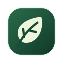
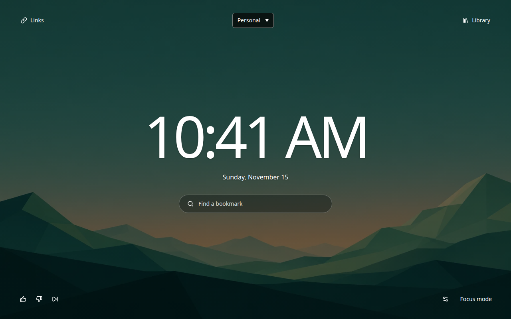
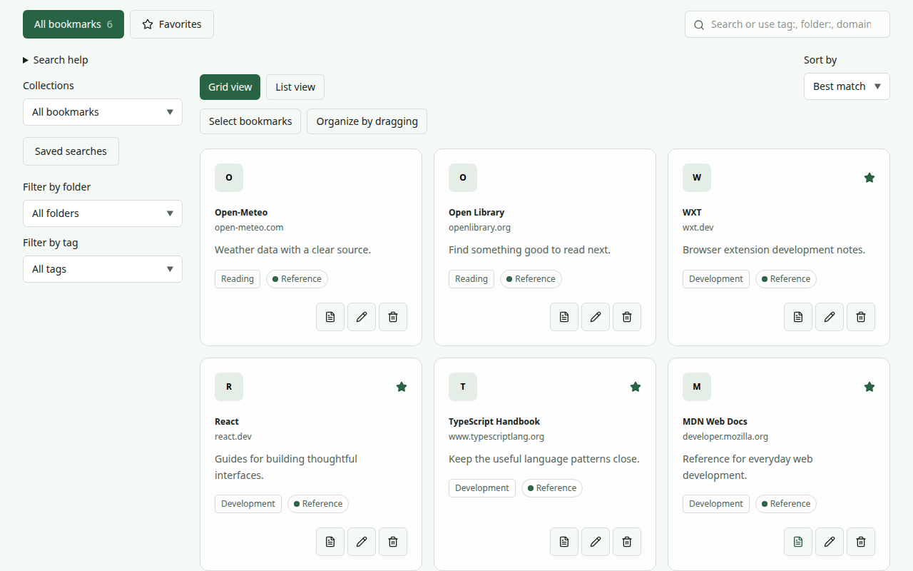

<p align="center">
  
</p>

<h1 align="center">Oasis</h1>

<p align="center">
  A quiet new tab and a home for your bookmarks.<br>
  Local-first. No account. No analytics.
</p>

<p align="center">
  <a href="#what-you-can-do">Features</a> ·
  <a href="#try-it-locally">Try it locally</a> ·
  <a href="PRIVACY.md">Privacy</a> ·
  <a href="https://github.com/AkosKappel/Oasis/issues">Support</a>
</p>



## What you can do

- **Start simply.** Choose a background, set your clock and add only the widgets you want: notes, tasks, focus timers or weather.
- **Find saved links.** Organize bookmarks with folders, tags and favorites. Search quickly or build a live collection from filters.
- **Save as you browse.** Capture a page through the toolbar, context menu or keyboard shortcut, then review it before saving.
- **Keep things separate.** Switch between independent spaces for work, learning and personal browsing.
- **Keep control of your content.** Undo removals, restore from Trash and move your data with imports, exports and complete-space backups.

<details>
<summary><strong>See the bookmark library</strong></summary>



</details>

_Screenshots show sample content and a bundled background._

## Local by default

Core features work offline. There is no backend, advertising or telemetry. Optional weather, submitted web searches and page-detail requests can contact the providers or websites you choose.

Save a reviewed window session into a bookmark folder, or reopen a folder in background tabs through Library’s Sessions and tabs tool. Tab-reading access is optional and requested only when you read the window.

Read the [privacy policy](PRIVACY.md) for data handling and permissions.

## Try it locally

Use **Node.js 24** and **pnpm 12**.

```sh
git clone https://github.com/AkosKappel/Oasis.git
cd Oasis
pnpm install
pnpm build
```

1. Open `chrome://extensions` or `edge://extensions`.
2. Enable **Developer mode**, then choose **Load unpacked**.
3. Select `.output/chrome-mv3` and open a new tab.

Chrome and Edge are the primary desktop targets. Firefox has an experimental build. See [browser support and testing](docs/BROWSERS.md) for coverage and verification status.

## Development

Built with WXT, React, TypeScript, Tailwind CSS and Dexie.

| Command      | Purpose                                      |
| ------------ | -------------------------------------------- |
| `pnpm dev`   | Start the WXT development environment        |
| `pnpm check` | Check types, lint, formatting and unit tests |
| `pnpm zip`   | Build a Chrome distribution archive          |

Browser test commands and release checks live in the guides below. Full extension suites run in CI.

## Further reading

[Architecture](docs/ARCHITECTURE.md) · [Design decisions](docs/DECISIONS.md) · [Browser support](docs/BROWSERS.md) · [Release guide](docs/RELEASE.md) · [Artwork](docs/ALBUM-ARTWORK.md)

---

Licensed under [MIT](LICENSE). [Report a bug or suggest an improvement](https://github.com/AkosKappel/Oasis/issues).
